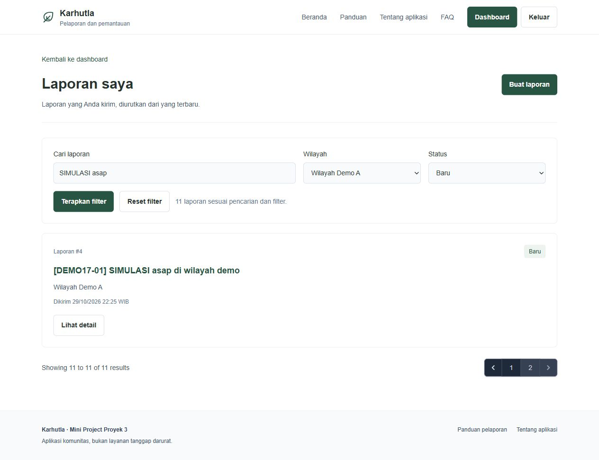

# Pengujian dan persiapan peer testing

## Hasil mandiri

Pengujian tahap 17 pada MySQL/MariaDB XAMPP port 2805 menghasilkan 511 tes PHP dengan 3.041 assertions dan 27 tes JavaScript lulus. Build aset dan formatter berhasil. `MiniProjectAcceptanceTest` menguji alur lintas fitur menggunakan data seeder; pengujian fitur lain memeriksa batas input, penolakan akses, rollback, konflik, dan integritas file secara lebih rinci.

| AC | Cakupan | Tes utama |
| --- | --- | --- |
| AC-01 | Login/logout, guest dan akun nonaktif | AuthenticationTest, RoleAuthorizationTest |
| AC-02 | Pembuatan laporan dan pemilik dari sesi | ReportSubmissionTest |
| AC-03 | Input lokasi/waktu tidak valid | ReportSubmissionTest, ReportUpdateTest |
| AC-04 | Jenis/ukuran bukti, unduhan privat, penggantian | ReportEvidenceTest |
| AC-05 | Ownership pada baca/edit/bukti | ReportOwnershipTest, ReportEvidenceTest |
| AC-06 | Transisi, kirim ulang, penerusan, penutupan | ReportWorkflowTest, CoordinatorForwardingTest, CoordinatorClosureTest |
| AC-07 | Akses berdasarkan peran pada endpoint langsung | RoleAuthorizationTest dan tes fitur terkait |
| AC-08 | Kondisi valid dan pelanggaran BR-01 sampai BR-07 | ReportUpdateTest, ReportWorkflowTest, AreaManagementTest dan tes koordinasi |
| AC-09 | JSON ringkasan sesuai scope dan fetch tanpa reload | AreaSummaryTest, area-summary.test.js |
| AC-10 | Pencarian/filter dengan ownership terjaga | ReportFilteringTest |
| AC-11 | Halaman kedua mempertahankan parameter filter | ReportFilteringTest, ReportFilterViewTest |
| AC-12 | Observer, aktor/waktu, rollback dan tampilan riwayat | ReportStatusObserverTest, ReportStatusHistoryViewTest |
| AC-13 | Ringkasan/tabel sesuai filter dan akses rekap | ReportRecapTest, ReportRecapViewTest |

## Skenario demonstrasi singkat

1. Jalankan migration dan seeding sesuai README. Pada database baru tersedia 26 laporan; seeding ulang tidak menimpa batch yang telah ada.
2. Login sebagai Pelapor pertama. Cari `SIMULASI asap`, pilih Wilayah Demo A dan status Baru. Hasil awal berjumlah 11; buka halaman 2 dan periksa filter serta URL.
3. Login sebagai Pelapor kedua. Pastikan daftar hanya menampilkan laporannya; akses langsung ID milik Pelapor pertama harus ditolak.
4. Pilih laporan demo berstatus Perlu Perbaikan untuk mencoba edit/kirim ulang. Pada Baru, Relawan dapat memulai tinjauan; pada Ditinjau, beri keputusan dan catatan.
5. Pada Perlu Diteruskan, Koordinator mencatat tujuan/waktu/catatan. Penerusan kedua ditolak. Setelah Diteruskan, Koordinator dapat menutup dengan catatan. Riwayat status bertambah otomatis.
6. Unduh contoh bukti, lalu uji unggahan valid serta file invalid pada laporan yang boleh diedit.
7. Buka rekap sebagai Relawan/Koordinator, pilih satu wilayah, dan cocokkan kartu dengan tabel. Pelapor tidak boleh membuka endpoint `/rekap`.

## Pengamatan fetch melalui DevTools

Login sebagai Pelapor, buka formulir Buat laporan, lalu DevTools > Network dan filter Fetch/XHR. Ganti wilayah. Periksa GET `/wilayah/{id}/ringkasan`, status 200, dan JSON `data` yang memuat `area_id`, `area_name`, `active_report_count`, serta `scope: milik_sendiri`. Isian formulir tidak hilang dan halaman tidak dimuat ulang. Jangan mengambil screenshot Cookie, token sesi, atau kredensial. Pengamatan Network pada sesi peer testing tetap dilakukan tester; screenshot tampilan saja bukan bukti Network.

## Bukti tampilan

## Versi dan status pelaksanaan

Tag `v1.0.0-peer-test` menandai versi kode yang disiapkan untuk pengujian. Migration/seeder dan pengujian otomatis telah diperiksa pada lingkungan lokal. Belum ada hasil peer acceptance dari mahasiswa lain; nama tester, tanggal, hasil tiap AC, dan temuan diisi saat sesi berlangsung. Laporan PDF diserahkan terpisah. File `.env` dan `.env.testing` tidak masuk Git.
