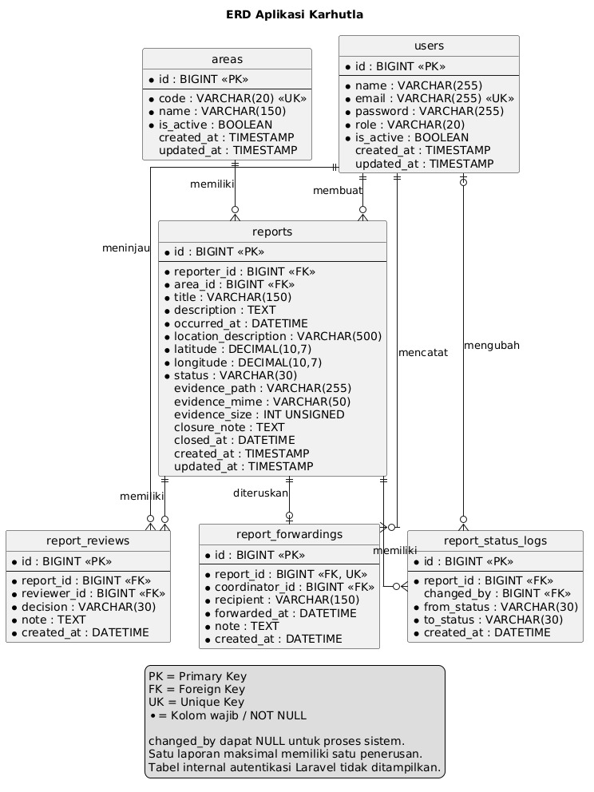
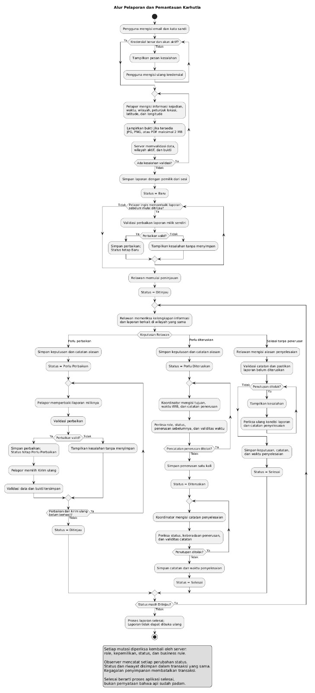

# Rancangan Karhutla

## Tujuan dan batasan

Satu proses utama mengelola laporan indikasi kebakaran dari masyarakat sampai proses komunitas selesai. Sistem tidak menetapkan kebenaran resmi kejadian, menjalankan pemadaman, mengirim pesan kepada pihak eksternal, atau menyediakan GIS kompleks.

## Aktor dan akses

| Aktivitas | Pelapor | Relawan | Koordinator |
| --- | --- | --- | --- |
| Membuat laporan | Ya | Tidak | Tidak |
| Membaca laporan dan riwayat | Milik sendiri | Semua | Semua |
| Mengunduh bukti | Milik sendiri | Semua | Semua |
| Memperbaiki isi/lokasi/bukti | Milik sendiri, Baru/Perlu Perbaikan | Tidak | Tidak |
| Memulai dan memberi keputusan tinjauan | Tidak | Ya, sesuai status | Tidak |
| Mengirim ulang | Milik sendiri, Perlu Perbaikan | Tidak | Tidak |
| Mencatat penerusan | Tidak | Tidak | Perlu Diteruskan, sekali |
| Menutup tanpa penerusan | Tidak | Ditinjau | Tidak |
| Menutup setelah penerusan | Tidak | Tidak | Diteruskan |
| Mengelola wilayah | Tidak | Tidak | Ya |
| Melihat rekap | Tidak | Ya | Ya |
| Ringkasan wilayah melalui fetch | Hitungan milik sendiri | Hitungan semua laporan | Hitungan semua laporan |

Semua fungsi internal memerlukan login dan akun aktif. Tidak ada pewarisan otomatis antara role. Pengaturan akun demo melalui seeder, tanpa antarmuka manajemen role khusus, sesuai ketentuan implementasi modul.

## Data dan relasi

Enam tabel bisnis: `users`, `areas`, `reports`, `report_reviews`, `report_forwardings`, dan `report_status_logs`. Satu pengguna dapat membuat banyak laporan; satu wilayah memiliki banyak laporan; satu laporan memiliki banyak review dan log, serta maksimal satu penerusan. Bukti disimpan sebagai metadata pada laporan dan file pada disk privat.

`report_forwardings.report_id` unik. Foreign key bisnis membatasi penghapusan referensi. `changed_by` boleh null untuk proses sistem. Review, penerusan, dan log hanya memiliki waktu pembuatan. Koordinat memakai DECIMAL(10,7). Waktu tersimpan dalam UTC dan dimasukkan/ditampilkan sebagai WIB.

## Status dan alur

| Dari | Ke | Pelaku dan syarat |
| --- | --- | --- |
| Pembuatan | Baru | Pelapor, data valid, wilayah aktif |
| Baru | Ditinjau | Relawan memulai peninjauan |
| Ditinjau | Perlu Perbaikan | Relawan, keputusan dan catatan |
| Perlu Perbaikan | Ditinjau | Pemilik mengirim ulang setelah validasi data tersimpan |
| Ditinjau | Perlu Diteruskan | Relawan, keputusan dan catatan |
| Perlu Diteruskan | Diteruskan | Koordinator, tujuan/waktu/catatan, belum pernah diteruskan |
| Ditinjau | Selesai | Relawan, alasan penyelesaian, tanpa penerusan |
| Diteruskan | Selesai | Koordinator, penerusan tersedia dan catatan penyelesaian |

Selesai bersifat final. Menyimpan perbaikan isi tidak mengubah status; kirim ulang merupakan tindakan terpisah.

## Business rule

| Kode | Aturan | Alasan |
| --- | --- | --- |
| BR-01 | Pemilik hanya memperbaiki isi/lokasi/bukti pada Baru atau Perlu Perbaikan. | Melindungi data yang sedang diproses. |
| BR-02 | Transisi mengikuti tabel; Selesai tidak dapat dibuka ulang. | Mencegah lompatan alur. |
| BR-03 | Keputusan review hanya pada Ditinjau dan disertai catatan. | Menyediakan alasan yang dapat ditelusuri. |
| BR-04 | Penerusan hanya oleh Koordinator pada Perlu Diteruskan dan maksimal sekali. | Mencegah penerusan prematur/ganda. |
| BR-05 | Penutupan mengikuti dua jalur kewenangan dan memerlukan alasan. | Memisahkan tinjauan dengan koordinasi. |
| BR-06 | Wilayah terpakai tidak dapat dihapus. Laporan baru/penggantian wilayah wajib aktif; wilayah lama nonaktif boleh dipertahankan. | Menjaga referensi historis. |
| BR-07 | Kirim ulang oleh pemilik hanya dari Perlu Perbaikan setelah data dan bukti tersimpan valid. | Mencegah pengiriman ulang data yang belum layak. |

## Komponen dan integritas

FormRequest memvalidasi input; middleware dan ReportPolicy membatasi akses; controller memproses tindakan dalam transaksi dengan penguncian baris dan pemeriksaan ulang status. Model menyediakan relasi dan scope pencarian. Blade/Tailwind menyajikan formulir sesuai izin. JavaScript mengambil ringkasan wilayah dan menangani loading, gagal, retry, serta respons lama.

Observer mencatat perubahan status setelah update model, dengan nilai lama/baru, akun pengubah, dan waktu server. Pembuatan awal serta edit isi tanpa perubahan status tidak menambah log. Log disimpan dalam transaksi tindakan; kegagalan log membatalkan status serta catatan proses terkait. Seeder menyusun riwayat historis secara eksplisit dengan model events dinonaktifkan agar tidak menggandakan log.

Guest HTML diarahkan ke login; JSON tanpa autentikasi mendapat 401; role salah mendapat 403; akses laporan Pelapor lain disamarkan sebagai 404; input invalid mendapat 422; konflik status mendapat 409. Penghapusan wilayah yang masih digunakan ditolak sebagai kesalahan validasi 422. Penolakan tidak boleh mengubah data/file.

## File dan interaksi

Satu bukti opsional JPG/JPEG, PNG, atau PDF maksimal 2 MB, diperiksa isi MIME dan ekstensi. File disimpan dengan nama acak di `storage/app/private/report-evidence`; unduhan melalui endpoint terotorisasi, bukan URL publik. Penggantian bukti mempertahankan file lama jika penyimpanan gagal.

`GET /wilayah/{area}/ringkasan` memberi JSON jumlah laporan aktif. Server menentukan scope berdasarkan sesi, sehingga parameter browser tidak dapat memperluas hitungan Pelapor. GPS hanya dijalankan setelah tombol dipilih dan izin diberikan; koordinat tetap dapat diisi manual.

## Pencarian dan rekap

Pencarian judul/petunjuk lokasi digabungkan dalam kondisi OR yang terkelompok, kemudian difilter wilayah/status. Pelapor tetap dibatasi pemilik. Pagination 10 baris, urutan waktu dan ID terbaru, mempertahankan parameter tervalidasi.

Rekap Relawan/Koordinator menggunakan filter wilayah. Tiga ringkasan adalah total, aktif (selain Selesai), dan selesai, disertai tabel per wilayah. Ringkasan berasal dari hasil tabel yang sama; total = aktif + selesai. Wilayah nonaktif dan kondisi tanpa laporan tetap dapat ditampilkan.
