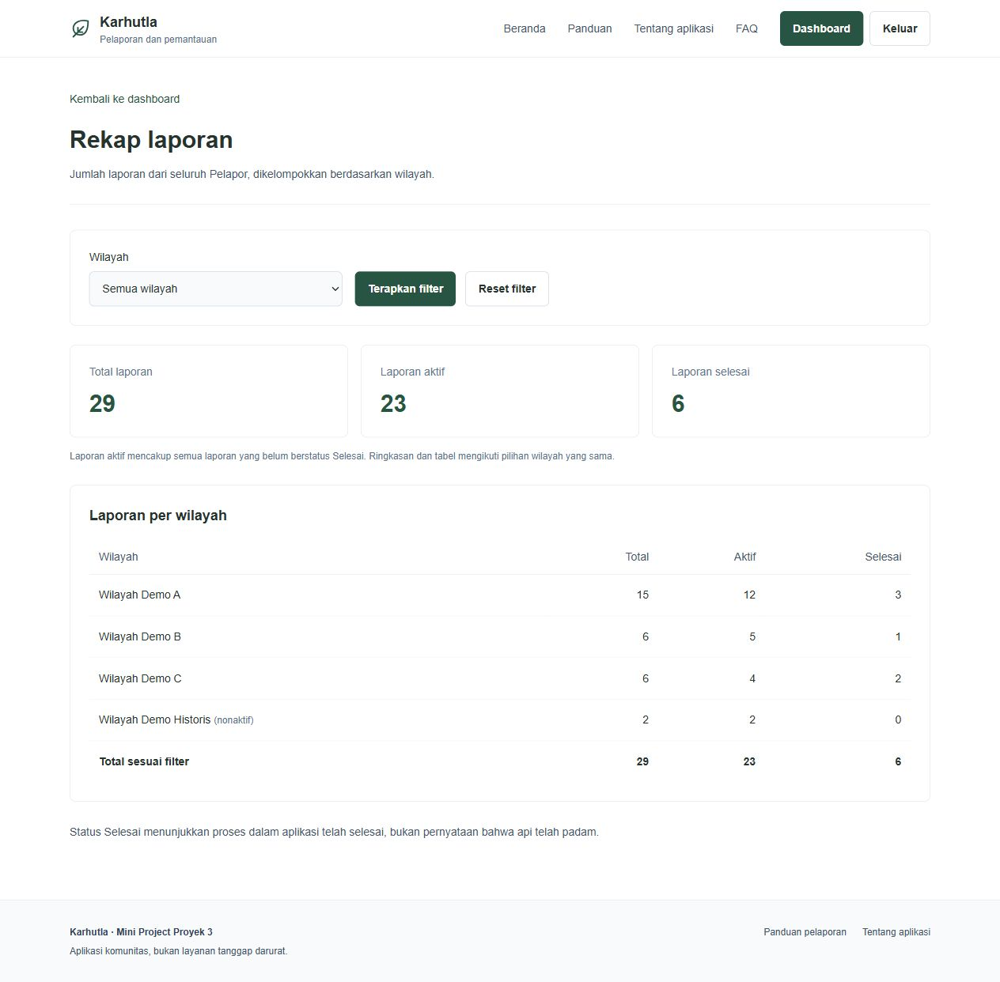

# Karhutla

Aplikasi komunitas untuk pelaporan dan pemantauan indikasi kebakaran hutan dan lahan. Dibangun untuk Mini Project Proyek 3 Kasus B. Peninjauan bukan verifikasi resmi; status Selesai berarti proses aplikasi selesai, bukan api telah padam.

## Identitas

- Nama: Putra Suyapratama
- NIM: 251511056
- Kelas: D3-2B
- Program studi: D3 Teknik Informatika
- Institusi: Politeknik Negeri Bandung
- Repository: https://github.com/hmzahiqball/proyek3-miniproject

## Fitur

Login/logout dan pembatasan tiga peran; CRUD wilayah; laporan dengan koordinat dan GPS opsional; satu bukti privat; perbaikan dan kirim ulang; peninjauan Relawan; penerusan tunggal dan penutupan Koordinator; pencarian, filter, pagination; fetch ringkasan wilayah; Observer perubahan status; rekap terfilter.

Pelapor hanya dapat mengakses laporannya sendiri. Relawan dan Koordinator memiliki kewenangan terpisah. Akun disediakan melalui seeder; aplikasi tidak menyediakan registrasi publik atau pengiriman pesan ke instansi.

## Kebutuhan lingkungan

- PHP 8.3 atau versi yang memenuhi `composer.lock`; pengujian dilakukan pada PHP 8.5.9 dan Laravel 13.39.0.
- Composer 2; ekstensi PHP PDO MySQL, Fileinfo, GD, Mbstring, OpenSSL, dan XML beserta persyaratan Composer.
- MySQL/MariaDB; konfigurasi proyek memakai XAMPP pada `127.0.0.1:2805`.
- Node.js 20.19+ atau 22.12+ sesuai kebutuhan Vite; pengujian memakai Node.js 22.20.0.
- Direktori `storage` dan `bootstrap/cache` dapat ditulis.
- Atur `upload_max_filesize` minimal `2M` dan `post_max_size` minimal `8M` pada PHP yang menjalankan aplikasi. Restart server setelah mengubah PHP.

## Instalasi

Contoh perintah berikut menggunakan PowerShell.

```powershell
git clone https://github.com/hmzahiqball/proyek3-miniproject.git
cd proyek3-miniproject
composer install
Copy-Item .env.example .env
php artisan key:generate
npm ci
npm run build
```

Nyalakan MySQL XAMPP pada port 2805. Buat database kosong, misalnya melalui phpMyAdmin atau klien MySQL:

```sql
CREATE DATABASE karhutla CHARACTER SET utf8mb4 COLLATE utf8mb4_unicode_ci;
```

Sesuaikan `.env` dengan akun database lokal Anda:

```dotenv
DB_CONNECTION=mysql
DB_HOST=127.0.0.1
DB_PORT=2805
DB_DATABASE=karhutla
DB_USERNAME=root
DB_PASSWORD=
```

`root` dan sandi kosong hanyalah contoh lingkungan lokal XAMPP. Gunakan kredensial lokal yang sesuai; jangan commit `.env`.

```powershell
php artisan config:clear
php artisan migrate --seed
php artisan serve --host=127.0.0.1 --port=8000
```

Buka http://127.0.0.1:8000. Untuk pengembangan aset, jalankan `npm run dev` pada terminal terpisah. Aplikasi tidak memerlukan queue worker, API eksternal, atau `storage:link` untuk bukti privat.

## Akun demo

Semua akun demo baru menggunakan sandi `KarhutlaDemo123!`.

| Peran | Email |
| --- | --- |
| Pelapor pertama | pelapor@example.test |
| Pelapor kedua | pelapor2@example.test |
| Relawan Pemantau | relawan@example.test |
| Koordinator Relawan | koordinator@example.test |

Seeder awal menyediakan empat akun, empat wilayah (satu nonaktif), dan 26 laporan pada enam status, disertai contoh JPG/PNG/PDF, review, penerusan, penutupan, dan riwayat. Semua data merupakan simulasi. Database yang telah digunakan dapat memiliki jumlah lebih besar; lingkungan demonstrasi saat dokumentasi disusun berisi 29 laporan karena tiga laporan sebelumnya dipertahankan.

```powershell
php artisan db:seed
```

Seeding ulang mempertahankan akun dan wilayah yang sudah ada. Batch laporan demo tidak diulang ketika penanda judul `[DEMO17-` masih ditemukan; seeder tidak mengembalikan perubahan pengguna atau merekonstruksi batch yang dihapus/diubah seluruh penandanya. Jangan memakai `migrate:fresh` pada database yang datanya ingin dipertahankan.

## Pengujian

Gunakan database terpisah berakhiran `_testing`, bukan database aplikasi:

```sql
CREATE DATABASE karhutla_testing CHARACTER SET utf8mb4 COLLATE utf8mb4_unicode_ci;
```

```powershell
Copy-Item .env.testing.example .env.testing
# Sesuaikan kredensial MySQL di .env.testing
php artisan key:generate --env=testing
php artisan config:clear
php artisan test --compact
node --test tests/js/area-summary.test.js tests/js/location-picker.test.js
npm run build
```

Pengujian database memakai RefreshDatabase yang membangun ulang database pengujian. TestCase menolak lingkungan non-testing atau nama database non-SQLite yang tidak berakhiran `_testing`. Jangan menunjuk `.env.testing` ke database aplikasi.

Hasil pengujian mandiri tahap 17: **511 tes PHP, 3.041 assertions, dan 27 tes JavaScript lulus**. Build Vite serta pemeriksaan formatter berhasil. Cakupan dan panduan peer testing terdapat pada [PENGUJIAN.md](PENGUJIAN.md).

## Rancangan dan bukti

Lihat [RANCANGAN.md](RANCANGAN.md) untuk akses, relasi, status, dan business rule; [ROADMAP.md](ROADMAP.md) untuk tahapan pengerjaan.



Versi kode untuk pengujian: tag `v1.0.0-peer-test`. Tag menandai kesiapan kode dan dokumentasi repositori; hasil peer testing belum diklaim. Laporan PDF disusun dan diserahkan terpisah setelah commit dokumentasi ini.
